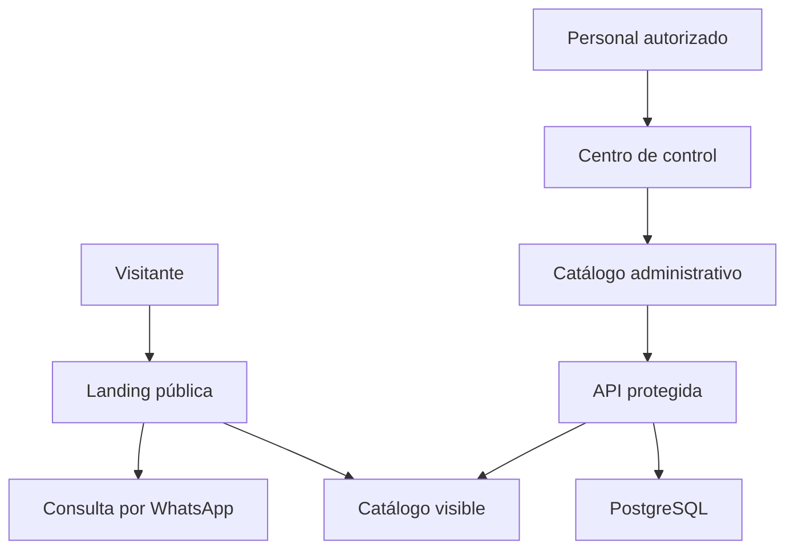

# Nova Bella — Guía de uso y administración

> **Boutique de calzado · Cochabamba, Bolivia**  
> Manual para conocer la tienda, navegar por el centro de control, interpretar sus indicadores y mantener la aplicación.

**Esta guía está escrita para dos públicos:** el equipo de Nova Bella, que necesita utilizar la aplicación sin conocimientos de programación, y la persona encargada de instalarla o continuar su desarrollo. No es necesario leer la sección técnica para entender las pantallas.

**Enlaces de la propuesta**

| Espacio | Enlace | ¿Para quién es? |
| --- | --- | --- |
| Tienda pública | [Landing Nova Bella](https://nova-bella-boutique-2026.keenorbit34.chatgpt.site/) | Clientes y visitantes |
| Administración | [Centro de control Nova Bella](https://nova-bella-centro-control-2026.keenorbit34.chatgpt.site/) | Propietarios y personal autorizado |
| Instagram oficial de referencia | [@novabella.bolivia](https://www.instagram.com/novabella.bolivia/) | Clientes y responsables de contenido |

**Contacto de la boutique:** Av. Heroínas, esquina Antezana, edificio Sky Box, piso 8, oficina 1B, Cochabamba. WhatsApp: **+591 71439946**. Verificar con la tienda estos datos antes de cualquier publicación comercial definitiva.

> **Estado de las versiones (19/11/2026):** este manual reúne las interfaces publicadas y la revisión más reciente del backend que se ha trabajado localmente. La rama `main` de GitHub todavía no incluye todos los archivos de esa revisión (entre ellos `backend/scripts/configure_local_database.py`, `backend/requirements-dev.txt`, `backend/PRODUCCION.md` y `render.yaml`). Los pasos que mencionan esos archivos se aplican **después de sincronizar los cambios locales pendientes**. La documentación no equivale a haber desplegado esos cambios.

---

## Índice

1. [Qué es Nova Bella y cómo funciona](#1-qué-es-nova-bella-y-cómo-funciona)
2. [Guía de la tienda pública](#2-guía-de-la-tienda-pública)
3. [Primeros pasos en el centro de control](#3-primeros-pasos-en-el-centro-de-control)
4. [Qué significa cada pantalla](#4-qué-significa-cada-pantalla)
5. [Diccionario de cifras y gráficas](#5-diccionario-de-cifras-y-gráficas)
6. [Ejemplos de tareas cotidianas](#6-ejemplos-de-tareas-cotidianas)
7. [De dónde salen los datos y qué se guarda](#7-de-dónde-salen-los-datos-y-qué-se-guarda)
8. [Preguntas frecuentes](#8-preguntas-frecuentes)
9. [Instalación local con Windows y Docker](#9-instalación-local-con-windows-y-docker)
10. [Arquitectura, API y seguridad](#10-arquitectura-api-y-seguridad)
11. [Problemas habituales y soluciones](#11-problemas-habituales-y-soluciones)
12. [Qué falta para el lanzamiento comercial](#12-qué-falta-para-el-lanzamiento-comercial)
13. [Guion breve para presentar la propuesta](#13-guion-breve-para-presentar-la-propuesta)

---

## 1. Qué es Nova Bella y cómo funciona

Nova Bella combina **dos experiencias distintas**:

- **La tienda pública (landing):** presenta el estilo de la marca, permite explorar modelos y facilita que una persona consulte por WhatsApp. No exige iniciar sesión ni procesa pagos en línea.
- **El centro de control:** organiza catálogo, consultas, ventas, clientes frecuentes y evolución comercial mediante indicadores. Está destinado a la administración, no a los visitantes.

Hay además una **API** (el programa que comunica las pantallas con el servidor) y una **base de datos PostgreSQL**. La conexión inicial ya permite administrar un catálogo mediante el servidor; el resto del panel conserva por ahora su información en el navegador hasta completar la integración.

### Mapa de funcionamiento



La flecha del catálogo hacia la landing representa una **conexión opcional**: solo se activa si la landing tiene configurada la URL pública HTTPS de la API y el catálogo está publicado. Las ventas, el seguimiento y las analíticas del panel **aún no se sincronizan automáticamente** con PostgreSQL.

## 2. Guía de la tienda pública

### 2.1. Portada y carrusel

Al abrir la página aparece una composición visual principal con fotografías y mensajes de la marca.

- Las **flechas** cambian la fotografía o el contenido destacado.
- Los **indicadores** permiten saber en qué diapositiva se está.
- El carrusel también puede avanzar automáticamente.
- La sección mantiene un tamaño visual estable al cambiar de imagen.

### 2.2. Colecciones

El visitante puede descubrir los modelos según sus preferencias:

| Categoría | Qué encontrará |
| --- | --- |
| **Tacones** | Opciones más formales, elegantes o para ocasiones especiales. |
| **Botas y botines** | Modelos altos, cortos y combinaciones para distintos conjuntos. |
| **Casuales** | Opciones de uso diario y propuestas versátiles. |

La categorización ayuda a explorar; no constituye un inventario confirmado por tallas.

### 2.3. Lookbook

El **lookbook** muestra ideas para combinar calzado y elegir una silueta: texanas, botines, tenis o tacones. Es una experiencia de inspiración visual. Desde ella se puede profundizar en un modelo relacionado.

### 2.4. Modelos destacados y catálogo

Según el contenido disponible, el visitante puede:

1. Explorar tarjetas de productos con fotografía, nombre y categoría.
2. Buscar un modelo o aplicar filtros.
3. Abrir la ficha para ver más detalles y seleccionar una talla para la consulta.
4. Marcar modelos como **favoritos**. Esta selección queda guardada en **ese navegador**, no en una cuenta.
5. Pulsar la opción de **WhatsApp** para consultar disponibilidad, talla y precio directamente a la boutique.

**Importante:** el botón de WhatsApp **inicia una conversación**, no crea una orden pagada. Cuando la tienda todavía no haya confirmado precios, puede mostrarse **«Consultar precio»**. Si la API pública está conectada, se presentan únicamente los productos publicados por la administración.

### 2.5. Preguntas, tallas y visita

- La **guía de tallas** ayuda a orientar una elección, pero es recomendable confirmar el ajuste y disponibilidad con el personal.
- Las **preguntas frecuentes** aclaran el proceso de consulta y compra.
- La sección **«Visítanos»** incluye una carta interactiva: al abrir el sobre aparece la información de ubicación y contacto.
- Los enlaces a **Instagram** y **WhatsApp** llevan a los canales de comunicación de la boutique.

### Qué no hace todavía la tienda

No procesa cobros, no emite facturas, no reserva automáticamente existencias, no incorpora carrito con pagos y no tiene registro de clientes finales. Esas funciones corresponden a una fase posterior.

## 3. Primeros pasos en el centro de control

El centro de control organiza el trabajo administrativo en un menú lateral. En pantallas pequeñas, el menú puede abrirse desde el botón de navegación.

**Orden recomendado para conocerlo:**

1. **Resumen:** entender la situación general.
2. **Análisis del negocio:** interpretar tendencias y metas.
3. **Ventas:** consultar y registrar operaciones.
4. **Clientes frecuentes:** comprender los segmentos y seguimientos.
5. **Catálogo:** revisar lo que se muestra al público.
6. **Consultas:** clasificar solicitudes de clientes.
7. **Conexiones y seguridad:** comprobar si hay un servidor conectado.

Los cambios efectuados en la interfaz no significan necesariamente que se hayan publicado en Internet. En especial, conviene distinguir entre **catálogo conectado a la API** y **módulos guardados localmente**; se explica con detalle en la [sección 7](#7-de-dónde-salen-los-datos-y-qué-se-guarda).

## 4. Qué significa cada pantalla

### 4.1. Resumen — el estado del negocio de un vistazo

En la portada administrativa se muestran:

- **Modelos del catálogo:** cantidad de fichas registradas en el catálogo de ese panel.
- **Modelos visibles:** cuántas de esas fichas tienen activada la visibilidad.
- **Consultas pendientes:** solicitudes que aún tienen el estado «Pendiente».
- **Cambios registrados:** acciones recientes anotadas en la actividad del panel.
- **Ingresos del mes:** suma de ventas registradas con fecha del mes actual.
- **Crecimiento mensual:** comparación de esos ingresos con los del mes anterior.
- **Tendencia:** gráfica de ingresos de los últimos seis meses.
- **Distribución del catálogo:** proporción de modelos de tacones, botas y casuales.

**Cómo leerla:** una mayor cantidad de consultas pendientes indica más trabajo por atender; un crecimiento positivo de ingresos puede indicar mejora comercial, pero necesita contrastarse con costos y contexto. Más productos visibles no significa automáticamente más ventas.

### 4.2. Análisis del negocio — evolución y decisiones

Permite elegir **últimos 3, 6 o 12 meses**. Al cambiar el período se recalculan los indicadores y varias gráficas.

Contiene:

1. **Ingresos del período:** cuánto suman las ventas registradas.
2. **Variación de ingresos:** cuánto cambió respecto de un período anterior del mismo tamaño.
3. **Ventas registradas:** número de operaciones, aunque una venta incluya varias unidades.
4. **Ticket promedio:** gasto medio por operación registrada.
5. **Clientes que repiten:** porcentaje de clientes identificados en el período que acumulan dos o más compras en el historial.
6. **Evolución de los ingresos:** gráfica mensual en bolivianos.
7. **Meta de ventas:** objetivo del mes en curso y avance alcanzado.
8. **Ventas por categoría:** participación de cada categoría en los ingresos.
9. **Modelos más vendidos:** clasificación por unidades vendidas, no por dinero generado.

**Para decidir:** observar varios meses suele ser más útil que interpretar una sola subida o bajada. Una categoría con mayor facturación puede justificar mayor atención comercial, pero para comprar inventario también importan margen, rotación y existencias, que esta versión todavía no calcula.

### 4.3. Ventas — registrar y consultar operaciones

Esta sección permite buscar operaciones, filtrar por mes y agregar una venta con:

- Producto vendido.
- Fecha de venta.
- Cantidad de pares/unidades registrados.
- Precio unitario en bolivianos.
- Cliente asociado (si se desea llevar seguimiento) o **venta ocasional**.

El sistema calcula el **importe total = cantidad × precio unitario**. Al registrar una venta en el panel, se actualizan los gráficos e indicadores asociados dentro de ese navegador.

La parte superior muestra el **número total de operaciones**, **ingresos acumulados** y **fecha de última venta**. No sustituye al sistema de facturación, contabilidad ni al control físico de caja. Tampoco descuenta automáticamente existencias por talla.

### 4.4. Clientes frecuentes — entender y cuidar relaciones

Cada cliente puede manejarse mediante un **alias**, sin introducir nombre completo, teléfono ni datos sensibles. El perfil registra:

- Estilo preferido: tacones, botas, casuales o sin definir.
- Segmento calculado a partir de compras vinculadas.
- Estado de seguimiento: **Pendiente**, **Contactado** o **Sin pendiente**.
- Próxima fecha de revisión/contacto, si aplica.
- Nota breve y últimas compras asociadas.
- Valor acumulado de las compras registradas.

**Segmentación:**

| Segmento | Regla actual | Interpretación |
| --- | --- | --- |
| **Sin compras** | 0 ventas asociadas | Perfil creado, todavía sin compras registradas. |
| **Primera compra** | 1 venta asociada | Ha comprado una vez. |
| **Recurrente** | 2 a 4 ventas asociadas | Ya volvió a comprar. |
| **Frecuente** | 5 o más ventas asociadas | Registra varias compras y merece seguimiento personalizado. |

La clasificación se basa en **número de operaciones**, no en bolivianos gastados. Una persona puede pasar de «Primera compra» a «Recurrente» cuando se registra una segunda venta asociada a su perfil.

Los indicadores principales de esta pantalla son **Perfiles**, **Clientes frecuentes**, **Con seguimiento pendiente** y **Valor por cliente**. Este último es el promedio de gasto histórico de perfiles **que sí tienen compras**, no el promedio de todos los perfiles creados.

> **Privacidad:** utiliza alias y notas comerciales respetuosas. No anotes contraseñas, datos bancarios, documentos de identidad ni información médica. Si se incorporan datos personales reales, habrá que implementar consentimiento, controles de acceso y una política de tratamiento de datos.

### 4.5. Catálogo — productos que ofrece la boutique

Permite buscar, crear y editar fichas con nombre, categoría, color, precio, descripción, imagen y estado de visibilidad según los campos disponibles.

- **Visible / publicado:** producto disponible en el catálogo público cuando ambas interfaces comparten la API.
- **Borrador / no visible:** queda en administración sin mostrarse públicamente.
- **Archivado:** modelo retirado conservando su referencia histórica en el servidor.

Si el panel **no está conectado**, sus modificaciones permanecen en el navegador. Si el panel **está autenticado contra la API HTTPS**, este módulo lee y escribe productos en PostgreSQL. En ese caso, la landing debe estar configurada con esa misma API para mostrar los cambios.

**Antes de publicar:** comprobar imagen autorizada, nombre exacto, precio vigente en Bs, categoría y disponibilidad real. Una fotografía no demuestra automáticamente que haya stock.

### 4.6. Consultas — organizar la atención

Presenta una lista de solicitudes con filtros y estados:

| Estado | Qué significa | Acción sugerida |
| --- | --- | --- |
| **Pendiente** | Todavía no se ha atendido. | Responder o asignar seguimiento. |
| **En seguimiento** | Ya hay conversación o gestión en curso. | Confirmar información faltante. |
| **Atendida** | La solicitud se considera resuelta. | Cerrar seguimiento. |

Marcar una consulta como «Atendida» **no envía automáticamente ningún mensaje**. El centro de control no importa conversaciones de Instagram ni WhatsApp por sí solo; el registro y los estados de esta versión se gestionan dentro del panel.

### 4.7. Contenido web — mensajes de la marca

Incluye campos de texto y vista previa para experimentar con titulares, descripciones y mensajes. Guardarlos modifica el contenido **del espacio de trabajo del panel**; **no reescribe automáticamente la landing publicada**. Para que un cambio aparezca en el sitio real se requiere la integración del contenido o una publicación de código.

### 4.8. Conexiones y seguridad — estado técnico

Aquí se introduce, cuando exista, la **URL HTTPS de la API**, el correo administrativo y la contraseña. El panel comprueba la salud del servidor y solicita un token temporal para la administración del catálogo.

| Mensaje o estado | Cómo interpretarlo |
| --- | --- |
| **Sin conexión** | El panel no está enlazado a una API. |
| **Enlace configurado** | Se introdujo una URL; por sí solo **no demuestra** que funcione. |
| **Servidor conectado** | Hubo una respuesta válida del servidor. |
| **No verificada** | Alguna parte del estado remoto no pudo confirmarse. |
| **Catálogo conectado** | La sesión administrativa puede operar sobre el catálogo vía API. |

**Muy importante:** que `http://127.0.0.1:8001` funcione en el ordenador del desarrollador **no quiere decir** que la API esté disponible para los sitios publicados en Internet. Para esa conexión es necesario desplegar una API HTTPS accesible de forma segura.

### 4.9. Actividad — historial de acciones

Registra acciones recientes realizadas dentro del panel y permite revisar cambios. El historial local conserva **hasta 100 registros recientes**; no constituye una auditoría legal completa. La API incorpora, por separado, una tabla de auditoría para sus operaciones protegidas.

### 4.10. Configuración — respaldo y restablecimiento

- **Descargar respaldo:** exporta un archivo JSON con datos del espacio de trabajo del navegador, como productos locales, consultas, contenido, ventas, clientes y actividad.
- **Restablecer datos:** devuelve **ese navegador** a sus valores iniciales y elimina cambios locales; **haz un respaldo antes**.

La descarga JSON sirve como copia de referencia, pero **la interfaz actual no ofrece una restauración/importación automática de ese archivo**. No prometas que descargarlo garantiza una recuperación con un clic.

## 5. Diccionario de cifras y gráficas

### 5.1. Indicadores comerciales

| Indicador | Cómo se calcula | Cómo interpretarlo |
| --- | --- | --- |
| **Ingresos (Bs)** | Suma de los importes registrados en el período. | Monto bruto registrado; **no es utilidad neta**. |
| **Operaciones / ventas** | Cantidad de registros de venta. | Una operación puede incluir más de un par. |
| **Unidades vendidas** | Suma de cantidades de cada registro. | Útil para identificar rotación por modelo. |
| **Ticket promedio** | Ingresos del período ÷ número de operaciones. | Gasto medio por compra. Si no hay ventas, no se puede calcular. |
| **Variación de ingresos** | `(ingresos actuales − anteriores) ÷ anteriores × 100`. | Positivo: subió; negativo: bajó. Con base anterior cero, no hay comparación porcentual válida. |
| **Meta mensual** | Monto objetivo fijado por administración. | Referencia interna, no una predicción. |
| **Cumplimiento de meta** | `ingresos del mes ÷ meta × 100`. | El indicador puede superar 100 % si se excede el objetivo. |
| **Participación por categoría** | `ingresos de la categoría ÷ ingresos totales × 100`. | Reparte el dinero vendido, **no** el número de productos. |
| **Clientes que repiten** | Clientes identificados en el período con al menos 2 compras históricas ÷ clientes distintos identificados en el período × 100. | Aproximación a fidelidad basada solo en ventas vinculadas a perfiles. |
| **Valor por cliente** | Promedio del gasto acumulado de perfiles con una o más ventas. | No representa rentabilidad individual ni incluye perfiles sin compra. |

**Ejemplos sencillos (solo para aprender los cálculos):**

- Si se registran **10 operaciones** por **Bs 2.500**, el ticket promedio es **Bs 250**.
- Si un período suma **Bs 7.000** y el anterior **Bs 5.000**, la variación es **+40 %**.
- Si la meta del mes es **Bs 9.500** y se registraron **Bs 7.600**, el cumplimiento es **80 %**.
- Si hay **8 clientes distintos identificados** en el período y **3** han comprado al menos dos veces en todo el historial, el indicador «Clientes que repiten» muestra **37,5 %**.

### 5.2. Cómo leer las gráficas

| Visualización | Eje o partes | Pregunta que ayuda a responder |
| --- | --- | --- |
| **Ingresos mensuales** | Meses en horizontal; monto en Bs en vertical. | ¿Estamos vendiendo más o menos con el tiempo? |
| **Resumen de seis meses** | Evolución reciente de ingresos. | ¿La tendencia general va en aumento? |
| **Meta de ventas** | Barra de progreso y porcentaje. | ¿Qué tan cerca está el objetivo del mes? |
| **Gráfica circular por categoría** | Porcentajes de ingresos de tacones, botas y casuales. | ¿Qué familia aporta más ingresos? |
| **Modelos más vendidos** | Posiciones según unidades registradas. | ¿Qué referencias se compran más veces o en más cantidad? |
| **Segmentos de clientes** | Cantidades por nivel de compras. | ¿Cuántos perfiles compraron una vez, varias o ninguna? |

**No confundir ingresos con ganancia:** la aplicación aún no descuenta costo de adquisición de zapatos, alquiler, sueldos, comisiones, devoluciones, impuestos ni otros egresos. Por tanto, no puede calcular de forma fiable margen, beneficio o flujo de caja.

## 6. Ejemplos de tareas cotidianas

### Caso A: se recibe un modelo nuevo

1. Abrir **Catálogo** y elegir **Nuevo producto**.
2. Escribir el nombre correcto, categoría, color, precio y descripción.
3. Agregar una imagen propia o autorizada.
4. Guardar primero como borrador si faltan verificaciones.
5. Comprobar tallas y stock con la tienda.
6. Publicar el modelo cuando todo esté confirmado.
7. Si el catálogo está conectado a la API, comprobar que la landing también apunte a la misma API y mostrar la página al público para verificarlo.

### Caso B: se vendieron dos pares

1. Ir a **Ventas** y seleccionar **Registrar venta**.
2. Seleccionar el modelo, fecha, cantidad **2** y precio unitario (por ejemplo **Bs 300**).
3. Vincular un perfil de cliente si corresponde, o elegir venta ocasional.
4. Confirmar el importe mostrado: **2 × Bs 300 = Bs 600**.
5. Guardar y revisar **Análisis** y **Resumen** para ver los indicadores actualizados.

No registrar operaciones inexistentes como si fueran ventas reales. Si se necesita corregir una venta, verificar las opciones efectivamente disponibles antes de crear registros compensatorios.

### Caso C: una clienta vuelve a comprar

1. Abrir **Clientes frecuentes** y localizar su alias, por ejemplo «Cliente 014».
2. Asociar la venta nueva con el mismo perfil en **Ventas**.
3. Comprobar que se actualicen el historial y el segmento calculado.
4. Registrar una nota breve y, si hace falta, fijar **seguimiento pendiente**.

La consistencia del alias es importante: crear dos perfiles para la misma persona divide su historial y distorsiona la fidelidad.

### Caso D: llega una pregunta por Instagram

1. Atender el mensaje **en Instagram**.
2. Si el equipo usa el panel como registro de consultas, anotar o actualizar su estado allí según las capacidades de la interfaz.
3. Marcar **En seguimiento** si falta confirmar talla o disponibilidad.
4. Marcar **Atendida** al resolverlo.

El panel no envía la respuesta ni recibe los mensajes automáticamente.

### Caso E: preparar una reunión de resultados

1. Abrir **Análisis del negocio**.
2. Seleccionar **Últimos 3, 6 o 12 meses** según el objetivo.
3. Comparar ingresos y variación con el período anterior.
4. Revisar los modelos más vendidos y la participación de categorías.
5. Comprobar ventas recurrentes y seguimientos pendientes.
6. Anotar **acciones comerciales concretas**: modelos a promocionar, clientes a contactar y meta del siguiente período.

## 7. De dónde salen los datos y qué se guarda

Esta distinción es esencial para que todas las personas interpreten correctamente la propuesta.

| Elemento | Fuente en la versión actual | ¿Se comparte entre dispositivos? |
| --- | --- | --- |
| Fotografías y contenido principal de la landing | Archivos y textos publicados en el sitio. | Sí, porque forman parte de la página publicada. |
| Favoritos de un visitante | Almacenamiento de su navegador. | No; no hay cuenta de cliente. |
| Catálogo de la landing sin API | Selección incorporada al sitio. | La misma selección publicada para todos. |
| Catálogo con API HTTPS configurada | PostgreSQL, únicamente productos publicados. | Sí, desde una misma API. |
| Catálogo del centro sin conexión | Estado local del navegador. | No. |
| Catálogo del centro con autenticación API | PostgreSQL mediante rutas protegidas. | Sí, para ese módulo. |
| Ventas, clientes y analíticas de las pantallas actuales | Datos iniciales de presentación y cambios guardados en el navegador. | **No**; todavía no están sincronizados con la API. |
| Consultas y notas del panel | Registros locales del navegador. | No; no se importan de las redes sociales. |
| Actividad local | Acciones recientes en el dispositivo. | No; distinto de la auditoría del servidor. |

### Sobre los valores iniciales que ves en pantalla

Para mostrar cómo se verían las herramientas con actividad, el centro de control **incluye registros iniciales de ejemplo**: ventas distribuidas en varios meses, perfiles identificados por alias, consultas y modelos. Las cantidades, crecimientos, clientes frecuentes y gráficos generados a partir de ellos **no están certificados como resultados reales de Nova Bella**. Se vuelven propios del negocio cuando se sustituyan por datos comprobados y se implemente la persistencia central correspondiente.

En una presentación es válido enseñar cómo se usan los indicadores; al explicar cifras concretas, conviene decir que son **un escenario ilustrativo de funcionamiento** y no afirmar que representan ingresos reales.

**Riesgo de pérdida de información:** vaciar datos del navegador, usar modo privado, cambiar de equipo o pulsar **Restablecer datos** puede hacer desaparecer los cambios que se guardaron localmente. Antes de modificar o restablecer, descargar una copia JSON y conservarla en un lugar seguro. El JSON exportado **no es todavía** un mecanismo automatizado de restauración.

### ¿Cuándo hay información real y centralizada?

La API puede guardar **productos, perfiles por alias y ventas** en PostgreSQL y ofrecer reportes mediante endpoints protegidos. Pero que esas rutas existan **no significa que las pantallas de Ventas, Clientes frecuentes y Análisis ya las estén consumiendo**. Para disponer de un cuadro de mando único en todos los equipos habrá que conectar esos módulos explícitamente, migrar datos autorizados, configurar respaldos y verificar integridad.

## 8. Preguntas frecuentes

**¿Necesito una cuenta para mirar los zapatos?**  
No. La landing es de acceso público.

**¿El cliente compra directamente desde la web?**  
No. Por ahora explora modelos e inicia una consulta por WhatsApp.

**¿Por qué no veo el mismo catálogo en la landing y en el panel?**  
Porque pueden estar mostrando selecciones locales distintas. Solo se sincronizan cuando ambos consultan la misma API configurada.

**¿Por qué cambian los gráficos cuando registro una venta?**  
Porque se calculan a partir de las operaciones almacenadas en el espacio de trabajo de ese navegador.

**¿Por qué las cifras cambian al elegir 3, 6 o 12 meses?**  
Porque se filtran las ventas por período y se vuelve a calcular el total, el promedio y la comparación.

**¿El porcentaje de clientes que repiten es sobre todas las ventas?**  
No. Se calcula sobre los **clientes identificados distintos** del período; para clasificar a uno como recurrente se consulta su historial de ventas.

**¿Si guardo en «Contenido web» cambia la página pública al instante?**  
No. Esa publicación automática aún requiere integración.

**¿Si la API está «healthy» ya funciona todo el sistema remoto?**  
No. Confirma que responde el servidor comprobado; también hay que verificar autenticación, conectividad desde ambas páginas, CORS, base de datos y funciones reales.

**¿Puedo usar la aplicación sin instalar Docker en mi equipo?**  
Sí, para visitar las dos páginas publicadas según sus permisos de acceso. Docker solo es necesario para ejecutar la API y PostgreSQL localmente.

**¿Qué significa Bs?**  
Bolivianos, moneda usada en los precios y reportes.

## 9. Instalación local con Windows y Docker

> Esta sección es para la persona que mantiene el proyecto. Las instrucciones asumen una copia del repositorio en `C:\Users\avend\Desktop\nova-bella-landing`, PowerShell, Python y Docker Desktop. Ajustar la ruta si se clonó en otra carpeta.

### 9.1. Requisitos

- **Navegador actualizado** para las interfaces.
- **Python 3** para un servidor web estático y scripts de configuración.
- **Docker Desktop** iniciado, con `docker compose` disponible.
- **Git** para actualizar la copia del repositorio (opcional para ejecutar lo ya descargado).
- Dependencias Python especificadas en `backend/requirements.txt` y `backend/requirements-dev.txt` para scripts y pruebas.

### 9.2. Abrir la landing en el ordenador

En PowerShell:

```powershell
cd C:\Users\avend\Desktop\nova-bella-landing
python -m http.server 5173 --directory dist
```

Abrir **http://127.0.0.1:5173/**. Para detener el servidor pulsar **Ctrl+C** en esa terminal.

> El comando se queda atendiendo solicitudes hasta que lo detienes: no escribas `cd` o `git clone` en esa misma sesión mientras está ejecutándose. Si aparece un `404`, comprueba que exista `dist\index.html` dentro de la carpeta desde la que lanzaste el comando.

### 9.3. API y PostgreSQL — puesta en marcha desde cero

El proyecto utiliza **dos contenedores**: `api` y `postgres`. La versión revisada prepara un rol de base de datos con permisos limitados.

**Si descargaste solo la rama `main` actual de GitHub:** sigue el procedimiento de `backend/README.md` correspondiente a esa revisión. Allí, `python -m scripts.generate_secrets` **muestra** el secreto y el hash para copiarlos manualmente a `.env`, y `docker compose up -d --build` inicia los servicios. No uses el procedimiento avanzado de abajo hasta que sus archivos se hayan incorporado al repositorio.

**Si tienes la versión local avanzada con `scripts/configure_local_database.py`:** utiliza este procedimiento de seguridad y rol limitado:

```powershell
cd C:\Users\avend\Desktop\nova-bella-landing\backend
Copy-Item .env.example .env
python -m pip install -r requirements.txt
python -m scripts.generate_secrets
```

En la versión local avanzada, el último comando solicitará el **correo administrativo** y una **contraseña** mediante entrada oculta; guarda en `.env` el hash y el secreto JWT. **Nunca subas `.env` a GitHub, lo envíes por chat ni tomes capturas que revelen secretos.**

Antes del primer arranque, `APP_DATABASE_PASSWORD` debe estar presente para que Compose pueda procesar su configuración. Si el `.env.example` de tu revisión no incluye esa clave, añade una entrada **temporal**, que el script siguiente reemplazará:

```powershell
if (-not (Select-String -Path .env -Pattern '^APP_DATABASE_PASSWORD=' -Quiet)) {
    Add-Content -Path .env -Value 'APP_DATABASE_PASSWORD=INICIALIZACION_TEMPORAL'
}
docker compose up -d postgres
python -m scripts.configure_local_database
docker compose up -d --build api
```

El script `configure_local_database` crea el esquema y una cuenta de aplicación limitada para **esta base Docker local**. No está diseñado para ejecutarse contra una base compartida o remota. Si tu copia del repositorio difiere de la versión descrita aquí, revisar primero `backend/README.md` y `backend/PRODUCCION.md`.

### 9.4. Comprobar que funciona

```powershell
docker compose ps -a
Invoke-RestMethod http://127.0.0.1:8001/api/v1/health
docker compose logs --tail=80 api
```

Se espera una respuesta con **`status: ok`**. En `docker compose ps -a`, los contenedores deberían aparecer como **Up (healthy)** después del arranque.

| Servicio local | Dirección | Para qué sirve |
| --- | --- | --- |
| Landing | `http://127.0.0.1:5173` | Presentación pública en tu PC. |
| API | `http://127.0.0.1:8001` | Lógica y endpoints. |
| Salud de la API | `http://127.0.0.1:8001/api/v1/health` | Verificar respuesta. |
| Documentación de API | `http://127.0.0.1:8001/docs` | Explorar operaciones disponibles. |
| PostgreSQL | `127.0.0.1:5434` | Base de datos local, acceso restringido. |

Para detener los contenedores sin eliminar el volumen de datos:

```powershell
docker compose down
```

**No uses `docker compose down -v` sin contar con una copia verificada:** la opción `-v` puede eliminar el volumen de PostgreSQL y sus datos.

### 9.5. Ejecutar pruebas

Desde la carpeta `backend` **cuando hayas sincronizado `requirements-dev.txt`**:

```powershell
python -m pip install -r requirements-dev.txt
python -m unittest discover -s tests -v
```

En una comprobación anterior de este proyecto se ejecutaron **14 pruebas, con 2 omitidas por requerir comprobaciones específicas de PostgreSQL**. Esto no reemplaza pruebas de extremo a extremo ni un control de seguridad antes de publicar. Si aparece un error mencionando `httpx2` desde `starlette.testclient`, instalar la dependencia exigida por la versión de Starlette instalada, preferiblemente a través de `requirements-dev.txt`; en el entorno de desarrollo reportado funcionó `python -m pip install httpx2`.

## 10. Arquitectura, API y seguridad

### 10.1. Tecnologías

| Capa | Tecnología | Responsabilidad |
| --- | --- | --- |
| Interfaz pública | HTML, CSS, JavaScript | Marca, modelos, navegación y contacto. |
| Centro de control | HTML, CSS, JavaScript | Gestión visual e indicadores. |
| API | Python + FastAPI | Validar solicitudes, autenticar y consultar/guardar datos. |
| Base de datos | PostgreSQL 16 | Productos, perfiles, ventas y auditoría del servidor. |
| Entorno local | Docker Compose | Ejecutar API y base de datos en contenedores. |
| Publicación propuesta | Servicios HTTPS (por configurar) | Conectar ambas páginas a la API en Internet. |

### 10.2. Endpoints principales

Todos los ejemplos usan como base `http://127.0.0.1:8001` durante el desarrollo local:

| Método y ruta | Uso | Protección |
| --- | --- | --- |
| `GET /api/v1/health` | Comprobar servicio. | Pública |
| `GET /api/v1/public/products` | Ver solo productos publicados. | Pública |
| `POST /api/v1/auth/token` | Iniciar sesión administrativa. | Credenciales requeridas |
| `GET /api/v1/admin/me` | Verificar sesión administrativa. | Token JWT |
| `GET/POST /api/v1/admin/products` | Listar y crear productos. | Token JWT |
| `PATCH/DELETE /api/v1/admin/products/{id}` | Editar o archivar producto. | Token JWT |
| `GET/POST /api/v1/admin/customers` | Listar y crear perfiles por alias. | Token JWT |
| `PATCH /api/v1/admin/customers/{id}` | Actualizar seguimiento. | Token JWT |
| `GET/POST /api/v1/admin/sales` | Consultar y registrar ventas. | Token JWT |
| `GET /api/v1/admin/analytics` | Obtener indicadores de la API. | Token JWT |
| `GET /api/v1/admin/audit` | Consultar eventos auditados. | Token JWT |

**Nota:** disponer de un endpoint no garantiza que la pantalla equivalente del panel esté enlazada. La conexión implementada en la interfaz administrativa es, por ahora, la del catálogo.

### 10.3. Seguridad básica

- La cuenta administrativa usa **hash scrypt** de contraseña y **JWT temporal**, no una contraseña escrita en el código del sitio.
- El token del panel conectado se guarda **en memoria durante la sesión**, no permanentemente en el navegador.
- Las rutas de administración requieren autenticación. El catálogo público expone solo productos **publicados**.
- **CORS** se restringe a los orígenes aprobados; no abrirlo indiscriminadamente a `*` en producción.
- Los puertos locales de Docker se enlazan a `127.0.0.1`; esto **no expone** automáticamente la API a Internet.
- La API utiliza una cuenta de base de datos con privilegios limitados, separada de la cuenta de mantenimiento inicial.
- El archivado de productos es lógico; conserva referencias históricas de ventas.
- Una solicitud de venta puede usar una clave de **idempotencia** para reducir registros duplicados ante reintentos.

Para hacer el servicio público se necesitan **HTTPS**, secretos privados configurados en el proveedor, certificados y base de datos correctamente preparados, verificaciones de seguridad, políticas de respaldo y control de acceso. **`render.yaml` es una configuración preparada, no una prueba de que el servicio remoto ya esté desplegado.** Consultar `backend/PRODUCCION.md` antes de cualquier lanzamiento.

### 10.4. Archivos y componentes de referencia

| Archivo o carpeta | Propósito |
| --- | --- |
| `dist/` | Archivos estáticos publicados para la landing. |
| `dist/api-config.js` | URL pública de la API que consulta la landing; no colocar secretos. |
| `backend/app/` | Código de la API. |
| `backend/compose.yaml` | Servicios Docker de API y PostgreSQL. |
| `backend/.env.example` | Plantilla de configuración, sin credenciales reales. |
| `backend/.env` | Credenciales locales privadas; ignorar en Git. |
| `backend/scripts/` | Generación de secretos; la preparación avanzada de la base está en la revisión local pendiente de sincronizar. |
| `backend/tests/` | Pruebas automáticas del servidor; parte de las pruebas nuevas aún están en la revisión local. |
| `backend/PRODUCCION.md` | Guía de preparación HTTPS, **pendiente de subir a `main`**. |
| `render.yaml` | Propuesta de configuración de despliegue, **pendiente de subir a `main`**. |

El **centro de control publicado** tiene sus propios archivos de interfaz y puede mantenerse como un proyecto/sitio separado; no asumir que todas sus páginas están dentro de `dist/` de la landing. Consultar la organización concreta del repositorio antes de mover archivos.

## 11. Problemas habituales y soluciones

| Síntoma | Causa frecuente | Qué hacer |
| --- | --- | --- |
| `404 File not found` al abrir `:5173` | El comando se inició desde una carpeta sin `dist/index.html`. | Entrar primero a la raíz del proyecto y repetir el servidor estático. |
| `no configuration file provided` en Compose | Se ejecutó desde fuera de `backend`. | `cd C:\Users\avend\Desktop\nova-bella-landing\backend`. |
| `cd backend` dice que no existe | Ya estabas dentro de `backend`. | Consultar la ruta actual con `Get-Location`. |
| La API muestra `Restarting (3)` | Falló al arrancar o validar configuración. | Revisar `docker compose logs --tail=80 api`. |
| Error de `JWT_SECRET` | Falta una clave aleatoria suficientemente larga. | Ejecutar `python -m scripts.generate_secrets` desde `backend` y recrear la API. |
| Error de `ADMIN_PASSWORD_HASH` | Falta el hash scrypt válido. | Generar credenciales con el script; no pegar contraseña en texto plano. |
| Error de `APP_DATABASE_PASSWORD` | No se creó la cuenta restringida/configuración local. | Completar el procedimiento de la sección 9.3. |
| Health no responde | La API no está levantada, reinicia o el puerto difiere. | Verificar `docker compose ps -a`, logs y puerto `8001`. |
| Error de importación `httpx2` en pruebas | Dependencia de cliente de pruebas faltante. | Instalar `requirements-dev.txt` o la dependencia indicada por la excepción. |
| Panel conectado, landing sin cambios | La landing no usa la misma API HTTPS o el producto no está publicado. | Verificar `dist/api-config.js`, estado del producto y API pública. |
| Datos distintos en dos computadoras | El módulo guarda información en cada navegador. | No asumir sincronización; hace falta conectarlo al backend. |
| API funciona en PC, pero no en un sitio alojado | `127.0.0.1` apunta a cada equipo, no al servidor del usuario. | Publicar la API en HTTPS y configurar URLs autorizadas. |
| Cambios desaparecieron tras restablecer | Se borró el estado local. | Consultar respaldos disponibles; no hay importación automática en la UI actual. |

## 12. Qué falta para el lanzamiento comercial

La propuesta ya permite recorrer la experiencia de marca y utilizar un panel de administración con indicadores. Para convertirla en una operación diaria fiable, estas son las etapas pendientes más importantes:

1. **Validación comercial:** confirmar nombre, logotipo, autorización de fotos, textos, modelos, precios, tallas, stock, dirección y horarios.
2. **Persistencia central:** conectar Ventas, Clientes, Consultas, Actividad y Análisis a la API y eliminar dependencias del almacenamiento local para datos operativos.
3. **Publicación segura:** desplegar API y PostgreSQL con HTTPS, respaldos automáticos, monitoreo y control de acceso probado.
4. **Operación real:** definir reglas de cancelaciones, devoluciones, comprobantes, control de existencias y cierre de caja.
5. **Clientes finales:** diseñar registro/inicio de sesión solo cuando haya consentimiento, políticas de privacidad y gestión segura de cuentas.
6. **Analítica avanzada:** calcular margen y rentabilidad cuando se incorporen costos; medir campañas y conversiones con una política de consentimiento adecuada.
7. **Pruebas:** cubrir flujos completos desde ambos sitios, accesibilidad móvil, seguridad, fallos de red y recuperación de respaldos.

**Propuesta de prioridad:** primero conectar y verificar catálogo y ventas reales; después seguimiento de clientes y consultas; finalmente cuentas de cliente, fidelización e integraciones más complejas.

## 13. Guion breve para presentar la propuesta

Puedes mostrar el proyecto en este orden, en aproximadamente cinco minutos:

1. **Marca (45 s):** abrir la landing, mostrar carrusel, colecciones, lookbook y la carta de contacto.
2. **Interés del cliente (45 s):** buscar un modelo, abrir detalles, marcar favorito y mostrar cómo inicia la consulta por WhatsApp.
3. **Administración (60 s):** pasar al Resumen, explicar modelos, consultas, ingresos del mes y evolución.
4. **Decisiones (75 s):** abrir Análisis, cambiar el período y explicar ticket promedio, meta, categoría principal y fidelidad.
5. **Trabajo diario (45 s):** enseñar el registro de ventas, un perfil con seguimiento y el catálogo administrativo.
6. **Camino al lanzamiento (30 s):** explicar la conexión inicial con FastAPI/PostgreSQL y qué módulos se integrarán después.

Una forma clara de cerrar la explicación:

> **«Nova Bella combina una experiencia atractiva para descubrir calzado con un espacio de administración pensado para entender el negocio: qué se vende, qué clientes regresan y dónde conviene concentrar los esfuerzos. La interfaz ya demuestra esos procesos y la siguiente etapa es conectar la operación diaria con información verificada y centralizada».**

---

## Notas de mantenimiento y créditos

- **Marca y fotografías:** referencia de identidad proporcionada por la boutique, incluida su cuenta de Instagram. Antes del lanzamiento, confirmar los archivos originales, licencias, autorización de reutilización y derechos de imagen de cualquier material tomado de redes sociales o de fuentes públicas.
- **Ámbito de esta guía:** describe la versión de la propuesta revisada el **19 de noviembre de 2026**. Si cambian pantallas, nombres de indicadores, fuentes de datos o endpoints, actualizar también este README.
- **Datos de contacto:** confirmar periódicamente con Nova Bella.
- **Secretos y clientes:** nunca agregar al README contraseñas, tokens, cadenas de conexión, información de pago o datos personales identificables.

**Nova Bella · Boutique de Calzado · Cochabamba, Bolivia**
